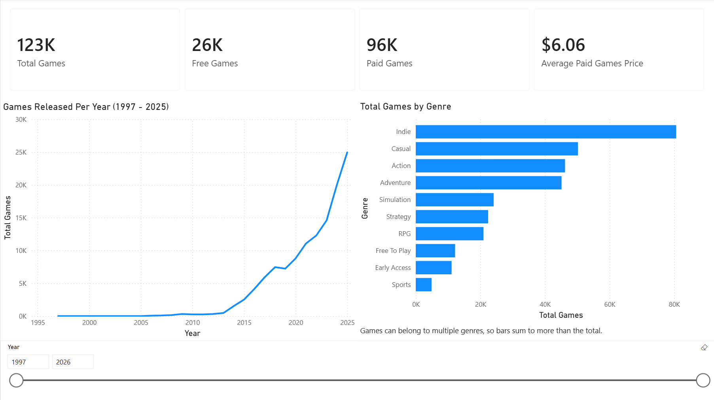
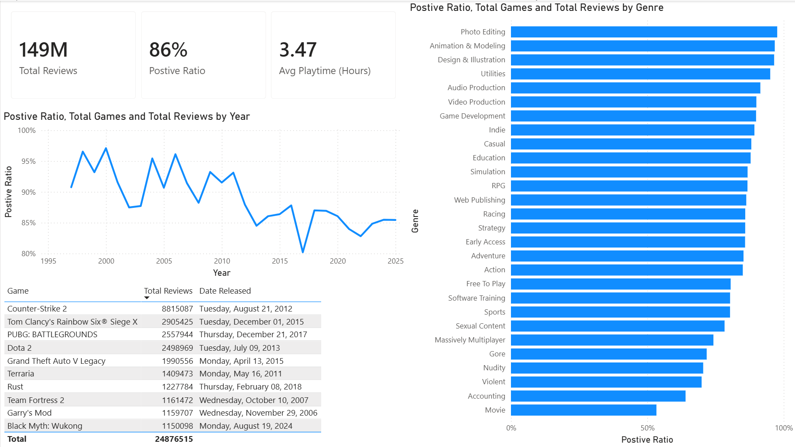

# Steam Games ETL Pipeline

This project builds an ETL pipeline for a Steam games dataset from Kaggle, loads cleaned and standardized data into a PostgreSQL database, and reports on it through a Power BI dashboard.

The pipeline supports **CSV and JSON** input formats, applies data cleaning and schema standardization, validates the data at two stages, and loads it into a **normalized PostgreSQL schema** using upsert logic for the main and lookup tables plus bridge-table loading for many-to-many relationships. A separate **star schema semantic model** sits on top of that database in Power BI for reporting.

Source:  
https://www.kaggle.com/datasets/fronkongames/steam-games-dataset/data

## Project Goal

The goal of this project is to practice and demonstrate core data engineering and analytics skills through a structured ETL workflow:

- extracting data from raw **CSV and JSON** sources
- cleaning messy real-world data
- transforming different source formats into a unified schema
- converting values into database-ready types
- normalizing one large flat dataset into relational tables
- loading cleaned data into PostgreSQL using **upsert** logic
- loading many-to-many bridge tables for repeated/list-like attributes
- validating the source file and the transformed data before anything is written
- validating the loaded data with SQL
- modeling the same data as a **star schema** for analytical reporting
- improving maintainability with modular pipeline components and environment-based configuration

## Tech Stack

- Python
- pandas
- NumPy
- PostgreSQL
- pgAdmin 4
- SQLAlchemy
- psycopg2
- Power BI (Power Query, DAX)
- Git / GitHub

## Current Pipeline Version

### V5 — Data Quality and Validation

The pipeline checks the source file and the transformed data before writing anything to PostgreSQL. The Kaggle dataset is actively maintained, so every refresh can bring both new data and changes to the file itself.

### Database Schema

Data is loaded into a normalized relational design rather than a single flat table.

**Main table**
- `steam_games`

**Lookup tables**
- `languages`
- `developers`
- `publishers`
- `categories`
- `genres`

**Bridge tables**
- `game_supported_languages`
- `game_full_audio_languages`
- `game_developers`
- `game_publishers`
- `game_categories`
- `game_genres`

## Key Features

- Supports **two input formats**:
  - CSV
  - JSON
- Modular ETL workflow:
  - extract
  - transform
  - validate
  - load
- Two-stage validation:
  - structural checks on the raw file
  - content checks on the transformed data
- JSON-to-tabular transformation aligned with the CSV pipeline structure
- Data cleaning for:
  - empty strings
  - empty lists
  - list-like text fields
  - messy language values
  - numeric/date conversion
- Splits `estimated_owners` into:
  - `estimated_owners_min`
  - `estimated_owners_max`
- Normalizes repeated text fields into lookup tables
- Builds bridge tables for many-to-many relationships
- PostgreSQL upsert logic for:
  - main table
  - lookup tables
- Bridge table loading with conflict-safe inserts
- Duplicate handling using:
  - `game_id` for the main table
  - unique text columns for lookup tables
  - composite keys for bridge tables
- Environment-based database credentials using `.env`
- Console and file logging for pipeline monitoring and debugging

## Data Modeling

Compared to a flat-table design, the normalized schema:

- splits one large table into multiple related tables
- reduces repeated text values
- properly models many-to-many relationships
- separates list-like attributes into lookup and bridge tables
- makes the database easier to query and maintain

## Example Transform Flow

The transform step includes:

1. rename source columns
2. select required columns
3. normalize empty values
4. log and fill missing game names
5. normalize list-like fields into Python lists
6. clean language fields
7. convert numeric and date columns
8. split estimated owners into min/max columns
9. build:
   - `steam_games` dataframe
   - lookup table dataframes
   - bridge table dataframes

## Load Flow

The load step works in three stages:

1. upsert the `steam_games` table
2. upsert lookup tables
3. load bridge tables by mapping lookup values to lookup IDs

Missing values are converted from `np.nan` to `None` at the DataFrame-to-records boundary so they land in PostgreSQL as real SQL `NULL`s rather than as `'NaN'` strings.

## Validation

The pipeline runs two gates. Both exist because the failures they catch are silent — the run completes, the log looks clean, and the data is wrong.

### Gate 1 — the raw file

Runs in `extract.py`, around `pd.read_csv`, so a bad file is rejected before a database connection is ever opened.

The source CSV ships with a malformed header: one missing comma fuses `Discount` and `DLC count` into a single field, giving 39 header fields against 40 data fields. The pipeline compensates by discarding the header entirely and applying a hardcoded column list positionally.

That makes an upstream header fix harmless — the header is never used. The real risk is a change to the **data**: a column added, removed, or reordered. The field count would still look plausible, nothing would error, and the positional override would stamp the wrong name on every column from the first moved one onward.

| Check | On failure |
|---|---|
| Data field count matches the configured column list | raises |
| Header field count is still the known-malformed 39 | warns |
| Header column names match the previous run | raises |
| Header column order matches the previous run | raises |
| Row count has not dropped past a configured tolerance | raises |

The last three compare against small baseline files in `data/metadata/`, written at the end of each successful run.

A failed check deliberately does **not** update its baseline. Updating it would mean the next run compares the new bad value against itself, finds no difference, and passes — the check would fire once and then go permanently blind. Recovery is manual: read the error, confirm the change is expected, delete the baseline file, rerun.

The row count tolerance exists because the dataset legitimately shrinks. Steam delists games constantly and the dataset is scraped, so small drops are normal churn. A large drop means a truncated download — and because the load is upsert-only and never deletes, a short file would leave the missing rows stale in the database rather than removing them.

### Gate 2 — the transformed data

Runs after type conversion, before anything reaches `load.py`.

| Check | On failure |
|---|---|
| Every row has a `game_id` | raises |
| Watched columns are not mostly NaN after type conversion | raises |
| Values are within possible ranges | warns |
| No duplicate `game_id` rows | raises |

**The NaN check** is the one that justifies the gate. If the source changes price from `19.99` to `$19.99`, `pd.to_numeric(errors="coerce")` turns all 125,000 prices into NaN without a word. They load as `NULL`, the run reports success, and the dashboard silently goes blank.

The limit applies to three named columns — `game_name`, `price`, `release_date` — rather than to all of them, because most columns in this dataset are legitimately mostly empty. `metacritic_url` is 96% NaN on a perfectly healthy run. A blanket rule would fire every time on columns that are fine, and a check that cries wolf gets ignored. Every other column is still counted and logged; only the watched three can stop the run.

**The range checks warn rather than raise**, because out-of-range values are usually source noise rather than corruption, and the same decision was already made for the nameless game: surface it, log the affected `game_id`s, keep the data.

One of them is worth calling out. `DimDate` in the Power BI model is generated with `CALENDARAUTO()`, which builds its range from the earliest and latest dates in the model — the extremes, not the bulk. A single placeholder release date of `9999-12-31` stretches the date table across thousands of empty days, fills the date hierarchy with blank years, and breaks the `Is Complete Year` flag, which measures against `MAX(FactGames[release_date])`. Type conversion cannot catch it: a placeholder date parses perfectly. It is valid and wrong.

**Duplicate `game_id` raises** rather than being quietly removed. `drop_duplicates(keep="first")` would arbitrarily pick whichever copy appeared first in the file and discard the other, silently. Lookup and bridge tables are not checked — both go through builder functions that already call `drop_duplicates`, and `.duplicated()` uses the same exact-string comparison, so it could only find what was already removed.

## Data Quality Handling

Two issues found while validating the loaded data, both fixed at the source rather than worked around downstream:

**`NaN` written instead of `NULL`.** pandas uses `np.nan` as its missing-value marker, but psycopg cannot convert a float `NaN` into SQL `NULL` — in text columns such as `metacritic_url` it landed as the literal three-character string `'NaN'`. That silently passed every `IS NULL` check and made the column look 100% populated. Fixed with a single conversion at the load boundary; the transform layer still uses `np.nan` throughout, as intended.

**A game with no name.** One record (`game_id` 396420) has no name in the source data — a real, published Steam title whose developer only supplied Japanese metadata. Rather than dropping the row or relaxing the `NOT NULL` constraint, the pipeline logs every affected `game_id` and fills the name with a traceable placeholder (`[UNNAMED - game_id X]`), so unusual-but-real data is preserved and identifiable.

## Dashboard

The Power BI report is built on a **star schema semantic model** layered over the normalized database.

### Catalog Overview

How large Steam's catalog is, what is in it, and what it costs.



### Reception

How the catalog is rated and how much of it people actually play.



### Why two different schemas

The PostgreSQL schema and the Power BI model describe the same data but are optimized for opposite workloads.

The **database** is normalized: it is written to by the pipeline, so it prioritizes storage efficiency and referential integrity. Repeated values live once in lookup tables, and many-to-many relationships are expressed through bridge tables with composite primary keys and cascading foreign keys.

The **semantic model** is a star schema: it is read from by report visuals, so it prioritizes fast aggregation and predictable filter propagation. `steam_games` becomes the fact table, and the lookup tables become dimensions.

Because a game genuinely can have several genres, categories, developers, publishers, and languages, the many-to-many relationships cannot be collapsed into direct one-to-many joins. The bridge tables are therefore carried into the model, with each dimension filtering its bridge in a single direction and each bridge relating to the fact table with **bidirectional cross-filtering** so a dimension filter can propagate through to the fact table.

Because `languages` serves two distinct purposes — supported languages and full audio languages — it is implemented as a **role-playing dimension**, split into two copies so that each has exactly one unambiguous filter path to the fact table. A single shared dimension would create two competing propagation paths and produce unreliable results.

A dedicated `DimDate` table is generated with `CALENDARAUTO()` and marked as the model's date table, keeping time attributes out of the fact table and enabling time intelligence.

### Measures

Defined in a dedicated `_Measures` table:

| Measure | Description |
|---|---|
| Total Games | Row count of the fact table |
| Free Games | Games priced at 0 |
| Paid Games | Games priced above 0 |
| Average Price | Mean price across all games |
| Average Paid Games Price | Mean price excluding free games |
| Total Reviews | Positive plus negative review counts |
| Positive Ratio | Positive reviews as a share of all reviews |
| Avg Playtime (Hours) | Mean lifetime playtime, converted from minutes |

### Known data caveats

These are properties of the source data, and are surfaced in the report rather than hidden:

- **Genre totals exceed the game count.** A game can belong to multiple genres, so it is counted once per genre it qualifies for. Individual bars are correct; their sum is not meaningful.
- **Partial years are excluded from trends.** The dataset was captured mid-year, so an `Is Complete Year` flag in `DimDate` compares each year against the latest release date present in the data and excludes years the data does not fully cover. Chart titles report the actual range shown.
- **Rating charts are filtered by review volume.** A game with a handful of reviews can post a perfect score, so the top-rated table applies a minimum review threshold, stated in the visual title.
- **The rating trend is by release year, not review date.** Reviews carry no timestamp in this dataset, so the trend describes how games released in a given year are rated today — not how sentiment changed over time.

## Project Structure

```text
steam_games_etl/
├── data/
│   ├── raw/
│   │   ├── games.csv
│   │   └── games.json
│   ├── cleaned/
│   └── metadata/
│       ├── last_header.csv
│       └── last_row_count.txt
├── images/
│   ├── Catalog.png
│   └── Reception.png
├── logs/
│   └── etl_pipeline.log
├── scripts/
│   ├── config.py
│   ├── extract.py
│   ├── load.py
│   ├── logger_config.py
│   ├── main.py
│   ├── test_connection.py
│   ├── transform.py
│   └── validate.py
├── sql/
│   └── create_steam_games_table.sql
├── .env
├── .gitignore
├── README.md
└── requirements.txt
```